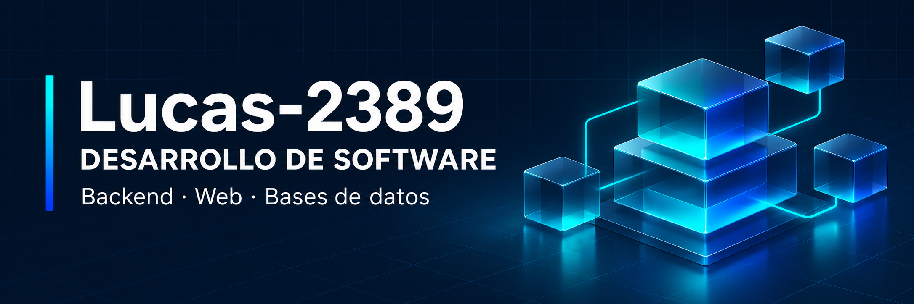

### Estudiante de Ingeniería de Sistemas · Desarrollador de software en formación

Construyo aplicaciones web, APIs y soluciones para problemas reales.

## Sobre mí

Estudio Ingeniería de Sistemas en la Universidad Nacional de San Cristóbal de Huamanga, en Ayacucho, Perú. Me interesa el desarrollo backend, las bases de datos y la arquitectura de software.

Aprendo desarrollando proyectos académicos y colaborativos: desde la definición de requisitos y el diseño de APIs hasta la implementación, las pruebas y la documentación. Mi objetivo es crecer como desarrollador de software junior y aportar soluciones útiles con código claro y mantenible.

## Tecnologías que utilizo en mis proyectos

  

| Área | Experiencia práctica |
| --- | --- |
| Backend | APIs con ASP.NET Core y Node.js/Express |
| Web y móvil | React, TypeScript y Flutter |
| Datos | MySQL, Entity Framework Core y migraciones |
| Forma de trabajo | Git, documentación técnica, contratos OpenAPI y pruebas |

## Proyectos destacados

### 01 · AlmacenCloud

**Gestión empresarial multiempresa para pequeñas y medianas empresas peruanas.**

Proyecto con inventario, movimientos, clientes, proveedores, ventas y compras. Incluye aislamiento por empresa, operaciones transaccionales y separación del backend en Domain, Application, Infrastructure y API.

`C#` `ASP.NET Core` `Entity Framework Core` `MySQL` `React` `TypeScript`

[Explorar código y documentación →](https://github.com/Lucas-2389/AlmacenCloud)

### 02 · Plataforma de gestión de incidencias

**Piloto académico en Ayacucho con aplicación ciudadana y panel institucional.**

Integra una aplicación Android en Flutter, un panel React y una API Node.js/Express con MySQL. El repositorio reúne requisitos, diseño de arquitectura, contrato OpenAPI y guías de colaboración. Su alcance es académico y no sustituye los servicios oficiales de emergencia.

`Flutter` `React` `Node.js` `Express` `MySQL` `OpenAPI`

[Explorar código y documentación →](https://github.com/Lucas-2389/Proyecto_incidencias_400par)

## Mi enfoque al desarrollar

- Entender los requisitos antes de implementar.
- Separar responsabilidades y mantener el código organizado.
- Cuidar la integridad de los datos y la configuración de secretos.
- Documentar decisiones para facilitar la colaboración.
- Aprender de las pruebas, la revisión y la mejora continua.

---

**Aprender. Construir. Mejorar.**

[Ver mis repositorios](https://github.com/Lucas-2389?tab=repositories)

